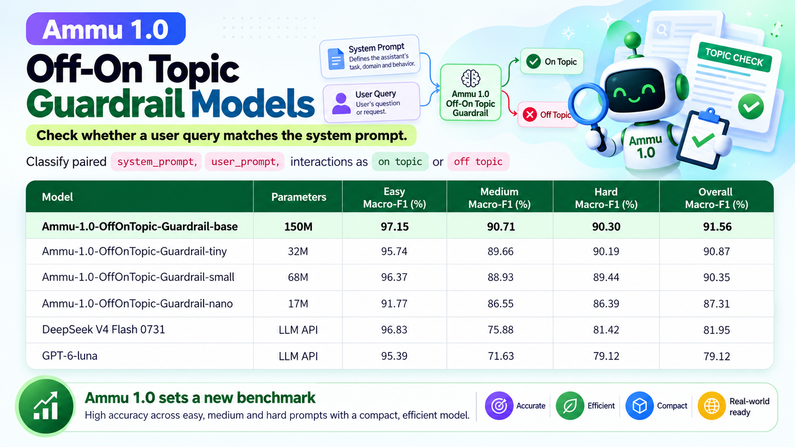

# 🛡️ Ammu-1.0-OffOnTopic: Lightweight Efficient Off On Topic Guardrail Models

<p align="center">
  <a href="https://huggingface.co/collections/kalyan-ks/ammu-10-off-on-topic-guardrail"></a>
  <a href="https://huggingface.co/datasets/kalyan-ks/off-on-topic-guardrail"></a>
  <a href="https://huggingface.co/spaces"></a>
  <a href="https://opensource.org/licenses/MIT"></a>
  <a href="https://www.python.org/downloads/"></a>
</p>

**Ammu-1.0-OffOnTopic** is a family of lightweight and efficient cross-encoder guardrail models trained to determine whether an incoming user query is on-topic (**`On Topic`**) or off-topic (**`Off Topic`**) relative to an AI assistant's system prompt (scope, domain boundaries, permitted tasks, and operational instructions).

<p align="center">
  
</p>

Built on the modern **ModernBERT** encoder architecture, the model family scales from **17M to 150M parameters** (`base` 150M, `small` 68M, `tiny` 32M, and `nano` 17M), achieving up to **91.56% Macro-F1** and outperforming frontier LLMs like DeepSeek V4 Flash 0731 (81.95%) and GPT-6-luna (79.12%) by **+9.61%** and **+12.44%** Macro-F1 points.

These models serve as an upfront guardrail and semantic router that intercepts out-of-scope requests before queries reach downstream generation LLMs or agentic workflows.

---

## ⚡ The Problem: Latency, Cost & Boundary Drift in LLM Systems

In production AI assistants and enterprise agents, relying on generation LLMs to police their own boundaries introduces severe operational penalties:

- **1,500–4,000 ms Latency Overhead**: Paying expensive autoregressive token generation time just to produce a refusal like *"I am only designed to assist with Python programming."*
- **Unnecessary Token Costs**: Wasting input and output token budgets on off topic user requests.
- **Vulnerability to Jailbreaks & Delimiter Spoofing**: Adversarial user queries can inject fake system instructions, disguise off-topic tasks, or slowly drift the assistant away from its defined scope.

```
                           System Prompt + User Prompt
                                       │
                                       ▼
                      ┌──────────────────────────────────┐
                      │  Ammu-1.0 Off On Topic Guardrail │  ◄── [Sub-5ms Cross-Encoder Decision]
                      └────────────────┬─────────────────┘
                                       │
               ┌───────────────────────┴───────────────────────┐
               ▼                                               ▼
          [ON TOPIC]                                      [OFF TOPIC]
  (Query within Permitted Scope)                  (Domain Escape / Prohibited)
               │                                               │
               ▼                                               ▼
    Route to Generation LLM                         Gracefully Decline Request
    or Agentic Tools (~Instant)                     (Bypass LLM: Save Cost & Latency!)
```

---

## 📊 Benchmark Leaderboard

Evaluated on the curated holdout benchmark test set of **4,008 balanced instances** from [`kalyan-ks/off-on-topic-guardrail`](https://huggingface.co/datasets/kalyan-ks/off-on-topic-guardrail) across three difficulty tiers (*Easy*, *Medium*, *Hard*):

| Model | Architecture | Params | Easy F1 (%) | Medium F1 (%) | Hard F1 (%) | Overall Macro-F1 (%) |
|:---|:---|:---:|:---:|:---:|:---:|:---:|
| `GPT-6-luna` | LLM API | - | 95.39 | 71.63 | 79.12 | **79.12** |
| `DeepSeek V4 Flash 0731` | LLM API | - | 96.83 | 75.88 | 81.42 | **81.95** |
| **Ammu-1.0-OffOnTopic-Guardrail-nano**<sup>*</sup> | ModernBERT | 17M | 91.77 | 86.55 | 86.39 | **87.31** |
| **Ammu-1.0-OffOnTopic-Guardrail-small** | ModernBERT | 68M | 96.37 | 88.93 | 89.44 | **90.35** |
| **Ammu-1.0-OffOnTopic-Guardrail-tiny**<sup>*</sup> | ModernBERT | 32M | 95.74 | 89.66 | 90.19 | **90.87** |
| **Ammu-1.0-OffOnTopic-Guardrail-base** | ModernBERT | 150M | **97.15** | **90.71** | **90.30** | **91.56** |

**Note**: \* — Tiny (32M) and Nano (17M) models are trained using knowledge distillation with `Ammu-1.0-OffOnTopic-Guardrail-base` as the teacher model.

### Key Highlights
- **Substantially Outperforms Frontier LLMs**: `Ammu-1.0-base` achieves **91.56%** Macro-F1, outperforming DeepSeek V4 Flash 0731 by **+9.61%** and GPT-6-luna by **+12.44%**.
- **Superior Boundary Discrimination on Nuanced Queries**: The performance gap is widest on `Medium` (+14.83% over DeepSeek, +19.08% over GPT-6) and `Hard` (+8.88% over DeepSeek, +11.18% over GPT-6) queries.
- **Available in multiple sizes**: Scales across 150M (base), 68M (small), 32M (tiny), and 17M (nano) sizes.
- **Native Paired Cross-Encoder Conditioning**: Evaluates joint interaction boundaries directly via `[CLS] system_prompt [SEP] user_prompt [SEP]`, eliminating delimiter injection vulnerabilities.
- **High Throughput & Sub-5ms Latency**: Delivers real-time CPU/GPU inference suitable for microservices, streaming gateways, and on-device deployment.
- **MIT Licensed**: Permissive open-source license ready for enterprise commercial adoption.

---

## 🚀 Quickstart

### 1. Installation

```bash
pip install transformers torch
```

### 2. Basic Inference (Hugging Face `pipeline`)

```python
from transformers import pipeline

# Choose from: 'base', 'small', 'tiny', 'nano'
classifier = pipeline(
    "text-classification",
    model="kalyan-ks/Ammu-1.0-OffOnTopic-Guardrail-nano",
    truncation="longest_first",
    max_length=1024
)

# Define your assistant's system prompt (scope & boundary rules)
system_prompt = (
    "You are a dedicated Python programming assistant. Your task is to help developers "
    "write, optimize, and debug Python 3 code, explain standard library modules, and review "
    "Python algorithms. Don't write code in other languages such as JavaScript, C++, or Java. "
    "Don't answer questions on non-programming topics such as sports, general cooking, or financial investing."
)

# Example 1: In-scope Python query
res1 = classifier({"text": system_prompt, "text_pair": "How do I implement a custom async context manager in Python 3.12?"})
print(res1)
# Output: {'label': 'Off Topic', 'score': 0.8424921035766602}

# Example 2: Out-of-scope other programming language
res2 = classifier({"text": system_prompt, "text_pair": "Can you configure a Redux store with reducers and middleware in React JavaScript?"})
print(res2)
# Output: {'label': 'Off Topic', 'score': 0.6343831419944763}
```

### 3. Production Guardrail Router Integration

```python
import torch
from transformers import pipeline

class OffOnTopicGuardrailRouter:
    def __init__(self, model_name="kalyan-ks/Ammu-1.0-OffOnTopic-Guardrail-nano", threshold=0.50):
        device = 0 if torch.cuda.is_available() else -1
        self.pipe = pipeline(
            "text-classification",
            model=model_name,
            device=device,
            truncation="longest_first",
            max_length=1024
        )
        self.threshold = threshold

    def is_on_topic(self, system_prompt: str, user_query: str) -> bool:
        prediction = self.pipe({"text": system_prompt, "text_pair": user_query})
        label = prediction['label']
        confidence = prediction['score']
        
        is_permitted = "on" in label.lower()
        return is_permitted and (confidence >= self.threshold)

# Initialize router
router = OffOnTopicGuardrailRouter()

system_prompt = "You are a customer service assistant for an apparel store. Assist with order tracking, returns, and refunds."

# Test incoming queries
query_1 = "Can you help me check the return status for order #12345?"
query_2 = "Write a beautiful poem on my latest shirt bought from the XYZ store."

print("Query 1 In-Scope:", router.is_on_topic(system_prompt, query_1))  # True -> Forward to LLM
print("Query 2 In-Scope:", router.is_on_topic(system_prompt, query_2))  # False -> Block & Decline
```

---

## 🧠 Methodology & Dataset Architecture

The models are trained and benchmarked on the **[kalyan-ks/off-on-topic-guardrail](https://huggingface.co/datasets/kalyan-ks/off-on-topic-guardrail)** dataset.

### 1. Comprehensive Domain Taxonomy (336 Specialized Domains)
The dataset samples comprehensively across diverse enterprise applications:
- **40 Major Industries across 336 Specialized Domains**: Healthcare, finance, civil engineering, cybersecurity, legal compliance, education, e-commerce, devops, library sciences, and more.
- **User Personas & Linguistic Registers**: 29 user personas across 4 expertise tiers (Novice, Intermediate, Knowledgeable, Expert), 8 linguistic registers and 9 emotional tones.
- **Calibrated Difficulty Tiers**: **16% Easy**, **39% Medium**, and **45% Hard**.

### 2. Hard Boundary Engineering & Orthogonal Distractors
The benchmark explicitly tests and overcomes shallow lexical shortcuts:
- **Surface Noise & Distractor Content**: User queries loaded with relevant technical keywords or benign setup chatter where the underlying request violates boundaries.
- **Subtle Boundary Bleed**: Inquiries that are closely adjacent to the target domain (e.g., asking a manuscript metadata cataloger about library circulation policies).
- **Adversarial Proximity**: Queries designed to sound helpful or aligned while asking the assistant to perform explicitly prohibited actions.

### 3. Quality Filtering 
- **Multi-Stage Quality Gates**: Deterministic programmatic validation followed by multi-criteria LLM Judge scoring across label correctness, prompt naturalness, taxonomy adherence, and training signal quality.
- **Stratified Partitioning**: 26,717 total instances partitioned into **Train (75%)**, **Validation (10%)**, and **Test (15%)** maintaining balanced label and difficulty ratios.

---

## 💻 Interactive Gradio Demo

An interactive Gradio application is included in [`app.py`](./assets/app.py) featuring:
- Real-time paired cross-encoder classification with live character and token monitoring.
- Interactive model switching across all 4 parameter scales (`base`, `small`, `tiny`, `nano`).
- ZeroGPU compatibility for Hugging Face Spaces.
- Pre-configured benchmark scenarios for instant demonstration.

To run locally:
```bash
git clone https://github.com/KalyanKS-NLP/ammu-off-on-topic-guardrail-models.git
cd ammu-off-on-topic-guardrail-models
pip install -r assets/requirements.txt
python assets/app.py
```

---

## 🔬 Reproducing the Benchmark

You can reproduce the evaluation benchmarks against the holdout test set using the standalone notebook:
- [`Evaluation Metrics Encoder Models.ipynb`](./assets/Evaluation%20Metrics%20Encoder%20Models.ipynb)

This loads the test split directly from Hugging Face Hub and executes deterministic evaluation in FP32 precision across all four encoder models.

---

## 📦 Model Collection Summary

| Model | Hugging Face Hub ID | Parameters | Recommended Use Case |
|---|---|:---:|---|
| **Base** | [`kalyan-ks/Ammu-1.0-OffOnTopic-Guardrail-base`](https://huggingface.co/kalyan-ks/Ammu-1.0-OffOnTopic-Guardrail-base) | 150M | Flagship accuracy, server-side gateway routing |
| **Small** | [`kalyan-ks/Ammu-1.0-OffOnTopic-Guardrail-small`](https://huggingface.co/kalyan-ks/Ammu-1.0-OffOnTopic-Guardrail-small) | 68M | High-throughput cloud microservices |
| **Tiny** | [`kalyan-ks/Ammu-1.0-OffOnTopic-Guardrail-tiny`](https://huggingface.co/kalyan-ks/Ammu-1.0-OffOnTopic-Guardrail-tiny) | 32M | CPU inference & low-cost serverless containers |
| **Nano** | [`kalyan-ks/Ammu-1.0-OffOnTopic-Guardrail-nano`](https://huggingface.co/kalyan-ks/Ammu-1.0-OffOnTopic-Guardrail-nano) | 17M | Ultra-low latency edge devices, streaming & mobile |

---

## 📜 Citation & License

This project is licensed under the [MIT License](LICENSE).

```bibtex
@misc{ammu2026offontopicguardrail,
  author = {Kalyan KS},
  title = {Ammu-1.0-OffOnTopic: Lightweight Off On Topic Guardrail Models},
  year = {2026},
  publisher = {Hugging Face},
  howpublished = {\url{https://huggingface.co/collections/kalyan-ks/ammu-10-offontopic-guardrail}}
}
```

